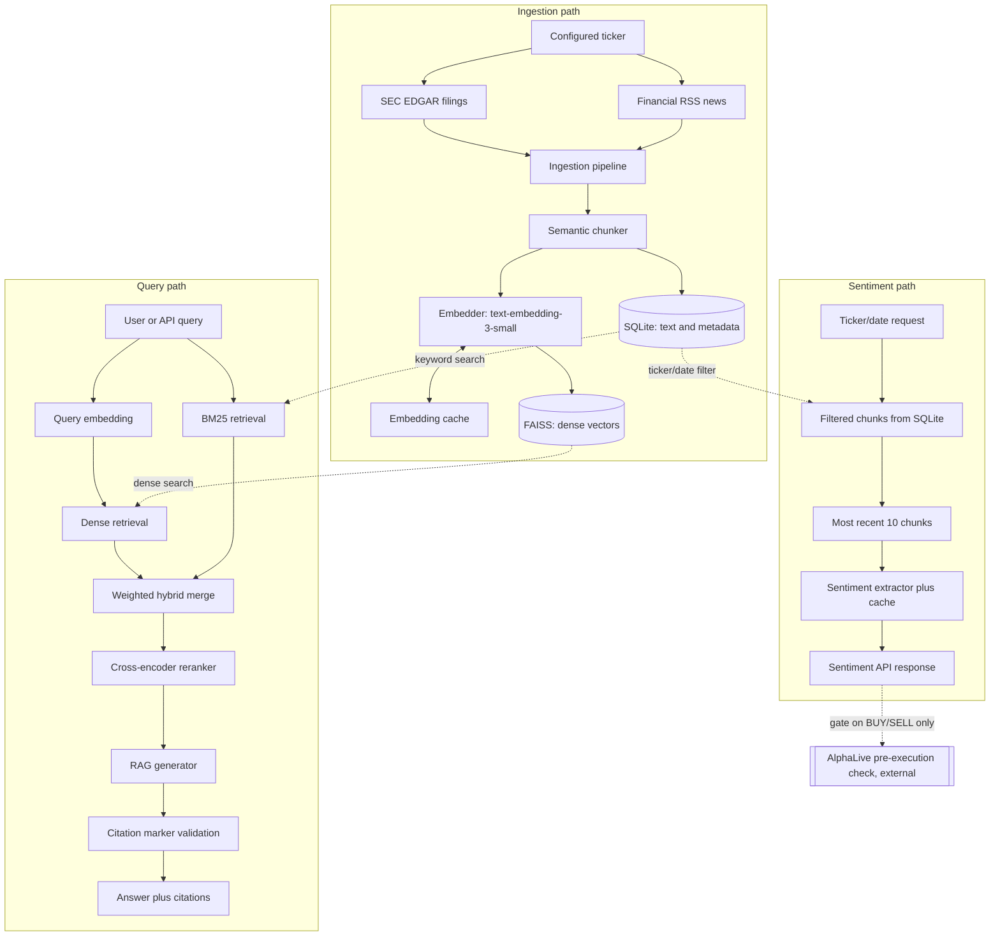

# AlphaSignal

AlphaSignal is a Python and FastAPI service that answers questions about SEC filings and financial news with source-linked citations, and separately produces a per-ticker sentiment signal. It retrieves with a hybrid of BM25 keyword search and FAISS dense vector search, reranks candidates with a cross-encoder, and generates answers that cite exactly the chunks they draw from. The sentiment signal is optional and status-aware: callers can tell "no data yet," "genuine neutral," "degraded extraction," and "fully failed" apart instead of one ambiguous score. It is consumed by [AlphaLive](https://github.com/bernardoguterres/AlphaLive), an execution and risk-management engine, as one input among several before it places a trade.

**Portfolio release.** The service runs end to end against a real local corpus, not a mocked design, and is backed by 406 passing tests covering software correctness: schema validation, citation-marker parsing, storage consistency, degraded-state handling, filter logic. Retrieval relevance and sentiment accuracy are separate questions this suite doesn't answer; see [Evaluation status](#evaluation-status) for what is and isn't measured.

## Status and evidence boundary

- **Runtime-verified:** the architecture executes against a real corpus. Citation integrity was checked against live queries with zero unresolved references, and the `/sentiment/{ticker}` no-data/degraded paths and AlphaLive's gate-bypass behavior were exercised against the running service.
- **Not benchmarked:** the 50-question golden set is unannotated, and the only retrieval measurement is one run of a 20-question draft development set (below), not a benchmark. No MRR/NDCG/Hit@k claims are made, and the sentiment fixture does not establish validated accuracy.
- **Not deployed:** Railway configuration is present and internally consistent, but has not been exercised as a running deployment.
- **406/406 tests passing, Black-formatted** (Ruff reports 23 pre-existing findings in scripts and tests) - validates software behavior, not retrieval relevance or sentiment accuracy. A coverage percentage is intentionally omitted since it was not remeasured after the most recent changes.

Nothing here is investment advice.

## Engineering highlights

- **Hybrid retrieval, not single-mode search.** Dense FAISS search catches semantic matches like "revenue" against "sales"; BM25 catches exact keyword matches embeddings can blur. Combined with a configurable weight (default 40% BM25, 60% dense).
- **Cross-encoder reranking as a second pass.** `cross-encoder/ms-marco-MiniLM-L-6-v2` scores each query-chunk pair jointly, a precision pass the cheaper bi-encoder stage can't do alone.
- **Citation integrity is an enforced invariant**, not a hope - see [Hybrid retrieval and cited generation](#hybrid-retrieval-and-cited-generation).
- **Explicit degraded-state API design for sentiment** - see [Sentiment and AlphaLive integration](#sentiment-and-alphalive-integration) and [`docs/sentiment_contract.md`](docs/sentiment_contract.md).
- **Defensive SQLite/FAISS consistency** - see [Ingestion and storage integrity](#ingestion-and-storage-integrity).
- **AlphaLive integration is scoped to entries, not exits, and fail-open by default** (`ALPHASIGNAL_FAIL_POLICY=open`: entries proceed when sentiment is unavailable, stale or late; `closed` blocks them), exercised as a local runtime test, not validated under live trading.

## Architecture



FAISS holds only dense vectors and chunk identities; SQLite holds chunk text and metadata. Retrieval queries both and joins on chunk ID. Sentiment never touches the query path's reranked chunks - it pulls its own ticker/date-filtered set from SQLite. AlphaLive is an external consumer of `/sentiment/{ticker}`, not part of this repository.

## Ingestion and storage integrity

`IngestionPipeline` (`alphasignal/ingestion/pipeline.py`) fetches SEC EDGAR filings and RSS news per ticker, then chunks them with `SemanticChunker`. `target_tokens` (default 300) drives ordinary boundary decisions; `max_tokens` (default 400) is the hard ceiling, forcing a split within an oversized sentence and capping `target_tokens` if configured above it. `min_tokens` (default 100) guides final-fragment handling but isn't an absolute floor. `overlap_tokens` (default 50) is a maximum budget for carrying complete trailing sentences forward, not a guarantee; a hard-split sentence carries none forward. Invalid configuration normalizes to a safe value with a logged warning.

Storage splits across two systems. **SQLite** (`data/metadata.db`) owns chunk text and metadata; **FAISS** (`data/faiss_index/`) owns dense vectors and chunk identities, addressed by the same source-derived chunk IDs. Both dedupe on chunk ID and a SHA-256 `content_hash`: unchanged re-ingestion is a no-op, while a content change under an unchanged ID (an amended filing) re-embeds and replaces the stale vector.

Consistency is enforced at query time, not assumed. A FAISS vector with no recorded `content_hash` - a hashless legacy cache entry, or one added through the identity-only fallback path - is treated as unverified and excluded from dense retrieval until re-ingestion produces a hash-verified vector. A vector whose hash disagrees with the chunk's current SQLite hash is excluded the same way, as a known mismatch. Neither case hides the chunk entirely: BM25 is built from current SQLite text independently of FAISS, so an excluded chunk can still surface through keyword relevance, reported with `dense_score=0.0`. Consistency-warning logs report chunk IDs and mismatch type, never document text.

**Reporting periods and tables (2026-10).** Each filing chunk stores `period_end`, the SEC header's "CONFORMED PERIOD OF REPORT". This is kept separate from `date` (the filing date), and a header without a period leaves it NULL; it is never filled with the filing date. `alphasignal/scripts/migrate_reporting_period.py` backfills an existing database from the raw filings on disk. It works on a copy, keeps `<db>.pre-period-<date>` and swaps the file in with one atomic rename.

Numeric tables, which prose extraction drops, are extracted separately (`alphasignal/ingestion/tables.py`) and appended after a filing's prose chunks, in sections named `<item>_table`. Each piece carries:
- the filing and its reporting period;
- the table heading and units;
- the column headings;
- every value labelled with its column's period, e.g. `Revenue: Year Ended Jan 26, 2025 = 130,497`.

Values are matched to period headings in order when the counts agree, because filings often put headings and values on different column grids. Otherwise they are matched by column position, and a column is left unlabelled rather than guessed. Tables that cannot be aligned are rendered `NOT ALIGNED`: every data cell in order, the headings as printed, and no period asserted. These are tables with text values between the numbers, or with one heading claiming several values in a row, such as JPM's preferred-stock and valuation-input tables. `NA`/`NM` placeholders and `(c)(f)` footnote markers do not break alignment. Tables whose period headings were shifted, or whose headings do not cover every value column, are also `NOT ALIGNED`.

**Accounting basis (2026-10-21).** Every table carries a `Basis:` line with the source words it rests on.
- **How it is read:** from the table's own introductory sentence, its column headings, its row labels and the footnote text after it, with Unicode dashes folded. The footnote stops at the next table's introduction, "See accompanying notes" or a "NOTE n" heading.
- **Possible values:**
  - `PRO FORMA`, `NON-GAAP`, `MANAGED BASIS` or `CONSTANT CURRENCY`; these combine, as in `PRO FORMA / NON-GAAP`;
  - `MIXED`, when headings also say "reported", or when only a footnote flags some figures;
  - `reported`, which needs an explicit statement heading or GAAP marker; a footnote flag on a reported statement is noted in the evidence;
  - `not stated`.
- **Retrieval:** non-reported tables stay out of the table lane unless the question asks for that basis. The reserved table slot prefers the requested basis, `reported` by default. A comparative column taken from a later filing is marked in the source header.
- **Generation:** the prompt allows a figure to be presented as reported only on a `reported` basis. Other bases must be labelled, MIXED or `not stated` must be qualified, and a comparative must name both the period and the filing.
- **Premise questions:** for retrieval only, a premise-bearing question ("net loss", "decline") is searched together with its neutral measure, so evidence contradicting the premise can be found.
- **Granularity:** the basis is per table. A single row labelled "managed basis" marks the whole table, which is conservative.

Table chunks are not used as sentiment evidence. `POST /ingest/{ticker}` takes `include_news: false` to re-ingest filings without changing the news.

**Versioned chunk ids and corpus versions (2026-10-21).**

*Chunk ids:* `<source_id>_<chunker version>_<index>`, for example `nvda_10k_86184b4a_ch3_0007`.
- `source_id` is the stable document identity: ticker, form and an md5 of filing date plus accession.
- `CHUNKER_VERSION` in `ingestion/chunker.py` is bumped whenever boundaries or table rendering change. A re-chunked document gets new ids, and re-ingestion deletes the document's old ids (by exact `source_id`); an old id is never pointed at new text.
- Ids from before versioning (`<source_id>_<index>`) count as `ch1`.

*Versions* are derived from the stored data (`store/versioning.py`):
- `corpus_version` is a digest of every chunk's id, content hash and provenance;
- `content_digest` (SQLite) and `index_digest` (FAISS) cover the (id, hash) pairs, and they must be equal for the database and vectors to be one version.

`/health` reports `corpus_version`, both digests, `corpus_consistent` (inconsistent means `degraded`) and chunks per chunker version.

*Snapshots and restore:* `python -m alphasignal.scripts.corpus_version {show,snapshot,verify,activate}` keeps snapshots in `data/versions/<corpus_version>/`.
- `snapshot` refuses an inconsistent corpus.
- `activate`, which is also the restore command, verifies the target and snapshots the active corpus as the recoverable backup. It then stages the target inside `data/`, swaps it in and re-verifies, rolling back if the result is not the expected version. Replaced files are moved aside, never deleted.

`evaluation/corpus_versions.json` records which corpus version each label and result file belongs to.

Each chunk carries an exact `source_id`. Re-ingesting a document compares its chunk set against only chunks already owned by that exact `source_id`, so removed or reflowed chunks are deleted without touching similarly named sources. Legacy rows without `source_id` fall back to a documented escaped chunk-ID-prefix match; an existing database is upgraded idempotently by adding the column with an empty default, never guessing legacy ownership. Cleaning up a source that now yields zero chunks requires the caller to supply its identity or prefix explicitly, since an empty chunk list can't reconstruct it - production ingestion paths already do this (see [Known limitations](#known-limitations)).

## Coordinated FAISS persistence

A save writes a complete, generation-numbered pair of files (a FAISS index and its chunk-ID list) rather than overwriting active files in place. The new generation is validated - dimension, vector count, no duplicate chunk IDs, agreement with the manifest's counts - before activation. A single small manifest atomically selects the current generation, so a crash between writing the new generation and updating the manifest leaves the previous, still-valid one active. Legacy flat index files are validated and migrated into this layout rather than assumed compatible. Only the current and previous generations are retained.

This is not a distributed transaction: SQLite, FAISS, and the embedding cache do not commit together. Recovery relies on idempotent re-ingestion plus the query-time exclusion of unverified or mismatched dense vectors described above.

## Hybrid retrieval and cited generation

`HybridRetriever.retrieve()` runs dense FAISS and sparse BM25 search independently over their own candidate pools (default 50), min-max normalizes both score sets, and combines them with configurable weights (default `bm25: 0.4, dense: 0.6`). The top `rerank_candidates` (default 20) go to `CrossEncoderReranker`, which returns the requested `top_k` (default 5, max 20).

**Filters:** a filtered dense search is an exact search over the filtered vectors. It used to take the corpus-wide top 3k and filter afterwards, so a ticker filter saw only the few of that ticker's chunks that happened to rank there.

**BM25 tokens** ignore punctuation (`2025?` matches `2025`).

**Period scope:** when the question names a fiscal period ("fiscal year 2025", "Q1 FY2027"; a bare year only for calendar-year companies), up to `period_scoped_candidates` (10) more candidates are drawn from that period's own filing: the 10-K for a year, the 10-Q for a quarter. If that filing is not in the corpus, the next year's filing for the same period is used, since it reports the requested period as a comparative. Fiscal labels come from the company's own 10-K period ends.

**Reranking:** the reranker sees each chunk with a source header (form, reporting period, filing date) and scores it as its best ~150-word sentence window (`rerank_window_words`; MaxP, Dai & Callan 2019). Table chunks are scored whole.

**Table lane (`table_lane`, on by default):** when a question names a fiscal period, financial-table chunks no longer compete with prose for the scoped slots.
- Tables are searched in their own lane, over that period's filing and the next one, which reports it as a comparative.
- A table is kept only if one of its column headings denotes the requested period: by date, quarter label ("2Q26") or fiscal year. Six- or nine-month columns are not a quarter. Tables marked NOT ALIGNED assert no period and stay out of the lane.
- Each table is scored by its best row, read with its heading, units and only the matching column.
- The final evidence has a fixed budget per lane: `table_slots` (1) goes to the best period-matched table when there is one, and the rest to the best prose. Table and prose scores are not compared; mixing them let row-scored tables push out useful prose and let unrelated prose beat the matched table in development runs. With no matched table it is the plain top_k.
- The source header names the matching column, and the prompt requires answers to give the row, column, period and units, and to name the later filing for a comparative figure.
- `table_lane: false` reproduces the 2026-10-20 single-pool retrieval.

**Trace:** `include_trace: true` on `/query` returns the ranked ids from each stage, for evaluation. `ALPHASIGNAL_CONFIG` points the service at another config file (used for evaluation variants).

`RAGGenerator` builds a numbered `[Source N]` context block from the reranked chunks, each labelled with its document type and reporting period separately from its filing date, and asks the model to answer only from it. The model is told to:
- assign figures to periods from the reporting period, never from the filing date;
- not blend periods;
- quote figures exactly as stated, with units and period;
- not derive sums, differences, growth rates or roundings unless a calculation is asked for, and to label any it does as calculated. `_parse_citations()` then enforces citation integrity before the response is returned: resolvable markers are renumbered sequentially, and any marker beyond what was retrieved is stripped from the answer text.

## Sentiment and AlphaLive integration

`/sentiment/{ticker}` pulls the ticker's chunks from SQLite independently of the query path and aggregates at the **document** level (`method: document_recency_weighted_v2`). Only evidence attributed to the company itself is used (`attribution`: filer, or a news item whose *title* names the ticker - body-only mentions are excluded), only documents dated on or before `as_of` (`date_to`, default today) and inside the freshness window (`sentiment.freshness_days`, default 30). Chunk scores within a document are confidence-weighted; documents are weighted by confidence × recency (half-life 7 days). A model result whose quoted evidence doesn't appear in the chunk text is marked unreliable. Scores are cached on disk keyed by content hash + model + prompt version, so a warm call doesn't re-query the model (measured: ~3.5 s cold, ~0.07 s warm for 8 fresh documents). The response also carries `as_of`, `documents_used`, `last_document_date` and a per-doc-type `coverage` report listing missing years.

The response distinguishes five situations, documented in full in [`docs/sentiment_contract.md`](docs/sentiment_contract.md) - the machine-readable API contract for telling successful, no-data, partially degraded, fully degraded, and failed requests apart. `status: "ok"` covers genuine extraction including genuine neutral sentiment (`latest_score` may legitimately be `0.0`). `status: "no_data"` means no chunks were ever ingested, returning `latest_score: null`. `status: "stale"` means data exists but none inside the freshness window - also `latest_score: null`, never an old score presented as current. Partial degradation means some chunks fell back to a provider/parsing default while others produced a real prediction; it returns the most recent *reliable* score, flagged `status: "degraded"`, `degradation_reason: "partial_extraction_failure"`. Full degradation means every chunk fell back, returning `latest_score: null` rather than a fabricated value, flagged `"full_extraction_failure"`. Unhandled failures raise as HTTP 5xx, never a misleading 200. Per-chunk `SentimentSignal.reliable` and response-level `reliable_chunk_count`/`total_chunk_count` make the fallback-versus-genuine split explicit. `/sentiment/{ticker}/summary` builds its aggregate score and trend from reliable signals only, reporting the same degradation metadata.

AlphaLive's `run_pre_execution_checks()` consults `/sentiment/{ticker}` only for strategy-generated BUY entries, never SELLs or protective exits, and reads the full contract rather than a bare score. A `no_data` or `stale` response, a timeout, a network/HTTP error, or a disabled integration is not evaluated; AlphaLive's `ALPHASIGNAL_FAIL_POLICY` (`open` by default, or `closed`) decides the entry, with a distinct logged reason. A degraded response that's unusable - no reliable chunks, or a null score - is handled by the same fail policy, with its own logged reason so it isn't confused with clean no-data. A degraded response that's structurally valid and usable - at least one reliable chunk and a non-null score - is evaluated against AlphaLive's normal threshold like any other score, but the decision is tagged partially degraded so it's never mistaken for one made on a clean signal. A malformed or self-contradictory contract is likewise left to the fail policy. Under the default `open` policy, then, sentiment is advisory only: every one of these cases lets the entry through. Passing or bypassing the gate never bypasses AlphaLive's own independent risk and execution checks.

AlphaLab does not call this API - it uses `yfinance` directly.

## Evaluation status

There are two separate, unrelated evaluation assets - do not confuse them:

| Asset | Purpose | Size | Status |
|---|---|---|---|
| `evaluation/retrieval_golden_set.json` | Retrieval quality (MRR/NDCG/Hit@k) | 50 questions, 10 tickers | Unannotated - `relevant_chunk_ids` empty everywhere |
| `alphasignal/evaluation/sentiment_golden_set.json` | Event-sentiment diagnostic fixture | 15 labeled events | Labeled, but methodologically limited as an accuracy measure - see below |
| `evaluation/eval_set_2026-10-19_draft.json` (+ `eval_run_2026-10-19.json`, `eval_run_2026-10-20_dev.json`) | Retrieval relevance, answer correctness and citation support, judged separately | 20 questions (MSFT/NVDA/JPM 10-Ks: facts, reporting periods, figures, unanswerable, false premises) | **Development set** (used while changing retrieval). Draft model-written labels with verbatim-checked passages; flagged items need human review |
| `evaluation/heldout_2026-10-20_draft.json` (+ `heldout_run_2026-10-20.json`) | Same three measures | 11 questions (AAPL/AMZN/TSLA/META prose, NVDA/MSFT/JPM table figures, unanswerable, false premises) | Inspected after its 2026-10-20 run and used to design the table lane: **development data now**, not untouched. 4 labels flagged for review |
| `evaluation/heldout3_2026-10-21_draft.json` (+ `heldout3_run_2026-10-21.json`) | Same three measures | 10 questions (table figures, comparative periods, prose periods, false premise, unanswerable, prose-not-displaced) | Labels written and source-checked before the code was frozen, run once. Model-drafted; 2 labels flagged |

**Retrieval:** `benchmark.py` refuses to run against the unannotated golden set rather than report meaningless all-zero metrics; annotation (`annotate_golden_set.py`) has to happen first. Its four configurations compare dense-only weighting, sparse-only weighting, configured hybrid weighting, and hybrid weighting with reranking on the same existing corpus. Each run uses an independent configuration; chunking is not varied. All rows still execute the shared retrieval pipeline, including both candidate searches and configured period/table lanes. These are scoring-weight comparisons, not pure dense-versus-sparse algorithm or cost ablations.

**Sentiment:** the 15-entry fixture carries explicit `expected_sentiment` labels, but `run_eval.py` calls `GET /sentiment/{ticker}?date_to=<event_date>` and never submits the event description to the model - it measures corpus context around a known date, not whether the model interprets a described event. Accuracy and the Sharpe-style backtest use only genuinely produced, available predictions; an unavailable one is never substituted with its own expected label, and prediction coverage (`predictions_available / actionable`) is reported separately. Events inside the 2020-2023 gap show up as reduced coverage, not a misleading result. Committed dated result files document this fixture's output, not validated accuracy.

**Initial draft check (2026-10-19, one run, frozen corpus snapshot, ticker filter, no date filter, top_k=5; single reviewer):** the top 5 held the evidence for 7 of 16 questions with evidence in the corpus (2 more partially). Answers: 8 correct, 1 acceptable, 5 correct abstentions, 5 abstentions where the evidence existed but was not retrieved, 1 wrong figure (FY2023 Microsoft Cloud revenue back-computed as $111.7B; stated $111.6B). No fabricated names; other periods were labelled rather than blended. Main weakness: reporting-period retrieval - questions about one fiscal year often retrieve another year's 10-K or a 10-Q. Financial-statement tables are not in the corpus, so table-only figures can only be abstained on. Twenty questions is far too few for rates; the set is now a development set and must not be presented as an untouched benchmark.

**Retrieval changes measured (2026-10-20, single reviewer).** The evaluation corpus was the frozen snapshot, with prose byte-identical, plus the reporting-period backfill and 15,065 table chunks for the NVDA/MSFT/JPM 2024-2026 filings. Retrieval is scored by content: a top-5 chunk contains the gold passage.

*Development set* (worked on during the changes, so optimistic). Gold evidence in the top 5:

| Stage | Answerable questions with evidence in top 5 |
|---|---|
| Run 1 | 7/16 |
| Period scope | 7/16 |
| + window reranking | 8/16 |
| + tables and comparative fallback | 10/16 |

Answers compared with run 1:
- correct: 9 (was 8);
- acceptable: 2 (was 1);
- correct abstentions: 5;
- wrong abstentions: 3 (was 5);
- failed premise rejection: 1, a regression on M4;
- wrong figures: 0 (was 1; N1 now quotes $111.6B instead of computing $111.7B).

With tables in the corpus, N4 and N5 became answerable, but the system still abstains on them.

*Held-out set* (one run, after the code was frozen; 9 answerable):
- gold evidence in the top 5 for 4 answerable questions, plus 1 partial;
- answers: 5 correct, 2 correct abstentions, 3 wrong abstentions (all three table-figure questions), 1 neither accepting nor rejecting a false premise;
- no wrong figures and no blended periods;
- citations: one unsupported phrase ("Gaming" as a revenue driver).

*Main remaining weakness:* table chunks reach the candidate pool through the period scope (the NVDA FY2025 income statement at rank 2), but the MS MARCO cross-encoder ranks `label: column = value` text low (12th to 27th). Table chunks also compete with prose for the 10 scoped slots. Eleven and twenty questions judged by one reviewer are not a benchmark.

**Fifth pass (2026-10-21): table lane, measured fairly.** All comparisons ran on one frozen corpus, `cv-0c6efe22a8359408`: frozen prose, reporting periods, and `ch3` tables for NVDA/MSFT/JPM. They used the same 31 development questions (the 20 dev items plus the 2026-10-20 held-out set, which was inspected and is now development) and the same answerability (`eval_labels_tables_v2`: N4/N5 are answerable with tables). One reviewer judged each answer against its cited text.

| Run | Correct | Acceptable | Correct abstain | Wrong abstain | Wrong figure | Premise not rejected | Partial |
|---|---|---|---|---|---|---|---|
| R1: tables, lanes off (2026-10-20 retrieval) | 15 | 2 | 5 | 7 | 0 | 1 | 1 |
| R3: no tables, final code | 12 | 2 | 5 | 9 | 0 | 2 | 1 |
| R4: tables, final code | 17 | 1 | 5 | 3 | 1 | 2 | 2 |

- **Evidence effect** (R3 to R4, same code): +5 correct, 6 fewer wrong abstentions.
- **Retrieval effect** (R1 to R4, same corpus): +2 correct, 4 fewer wrong abstentions, and requested table figures in the final evidence rose from 2/7 to 5/7.
- **Regressions:** M3 (no longer rejects the false premise) and H6 (a wrong figure).

*Separate set* (`heldout3_2026-10-21`, 10 items, labels fixed before the code was frozen, run once):
- retrieval found the evidence for 4/9 answerable items;
- answers: 4 correct, 1 correct abstention, 3 wrong abstentions (retrieval misses), 1 wrong figure, 1 partial;
- every citation supports the text it is attached to.

**New failure mode:** a pro-forma table has a column for the requested year (the Activision acquisition note), so answers quoted pro-forma revenue or net income instead of reported figures (H6, X5 wrong; H4, X6 partial, labelled pro forma). Retrieval still misses some income-statement tables and some prose (X1, X10).

**Accounting-basis pass (2026-10-21).**
- **The error:** H6 and X5 had quoted Microsoft's unaudited pro-forma Activision figures as reported revenue, and H4/X6 used them to reject premises.
- **Reproduced** on the running service before the fix.
- **Corpus:** `cv-6483342e98be8811`.
- **Development items after the fix** (19, including all four):
  - 18 correct on figure, accounting basis and period;
  - the pro-forma table is used only when asked for, and then labelled;
  - M3's premise ("net loss") is rejected with reported net income;
  - 1 abstention: a managed-basis total that was not retrieved.
- **Final separate set** (`final4_2026-10-21`, 7 questions, labels hashed before freezing, run once): 7 correct. 0 wrong figures, 0 wrong accounting basis, 0 wrong periods, 0 unsupported claims. One answer cites the later filing it took a comparative from but does not name it in the text.
- **Reviewer:** a fresh-context reviewer found basis-detection gaps, which were fixed before the freeze: combined bases, Unicode hyphens, "as though" wording, row labels, and neighbouring notes.
- **Normal corpus (no tables):** the same code changed only the premise questions' retrieval.
- **Caveat:** one reviewer and small samples; not a benchmark.

**Bottom line:** retrieval quality is not benchmarked and no validated sentiment or predictive-quality claim is made here. Closing the gap needs the retrieval questions annotated, benchmarked, and corpus coverage extended so "unavailable" is the answer less often.

**Local corpus evidence, not committed data:** `data/` is gitignored, so this describes this machine's local corpus, not what ships in or is reproducible from a fresh clone. `data/metadata.db` holds 42,078 chunks across the 12 configured tickers (AAPL, MSFT, GOOGL, AMZN, NVDA, META, TSLA, JPM, GS, MS, SPY, QQQ), with SEC coverage split across 2015-2019 (backfill) and 2024-2026 (regular ingestion) - 2020 through 2023 has no data for any ticker. Constrained requests get documented no-data behavior: `/sentiment/{ticker}` returns `data_available: false`/`latest_score: null`, `/query` returns an empty `citations` array.

## API example

Shapes below match `alphasignal/api/schemas.py`. Answer text, scores, and latency are illustrative - representative, not a captured live response.

```bash
curl -X POST http://localhost:8000/query \
  -H "Content-Type: application/json" \
  -d '{"query": "What were Apple'\''s key revenue drivers in fiscal 2024?", "ticker_filter": "AAPL", "top_k": 5}'
```

```json
{
  "query": "What were Apple's key revenue drivers in fiscal 2024?",
  "answer": "Driven primarily by iPhone sales and continued growth in Services [Source 1].",
  "citations": [
    {
      "chunk_id": "aapl_10k_a1b2c3d4_0007",
      "ticker": "AAPL",
      "source": "SEC EDGAR",
      "date": "2024-09-28",
      "excerpt": "iPhone revenue increased year-over-year...",
      "relevance_score": 0.91
    }
  ],
  "latency_ms": 340,
  "retrieval_scores": [0.91, 0.84],
  "model_used": "gpt-5.6-luna"
}
```

`ticker_filter` is a single string, not a list - the retrieval stack only ever supported one ticker per query.

## Quick Start

```bash
git clone https://github.com/bernardoguterres/AlphaSignal.git
cd AlphaSignal
python -m venv venv && source venv/bin/activate
pip install -r requirements.txt
export OPENAI_API_KEY=your_key_here

# Build the corpus (real OpenAI embedding calls - costs money)
python alphasignal/scripts/build_corpus.py

# Start the API
uvicorn alphasignal.api.app:app --reload --host 0.0.0.0 --port 8000
# docs at http://localhost:8000/docs
```

**Environment variables:** `OPENAI_API_KEY` (required); `ALPHASIGNAL_API_KEY` (recommended before public exposure) - when set, every route except `/health` requires a matching `X-API-Key` header. Unset means open access, logged as a startup warning - fine locally, not for a reachable deployment, since open `/query`/`/ingest` would let anyone spend the OpenAI budget.

**`config.yaml`** controls tickers, chunking, retrieval weights, model names, and storage paths.

**Railway:** `Dockerfile`, `Procfile`, and `railway.toml` are internally consistent configuration; an actual deployment has not been exercised. `data/` is excluded from the Docker image, so a real deployment needs a persistent volume at `/app/data` or every redeploy wipes the corpus.

## Compact API reference

| Endpoint | Purpose | Auth |
|---|---|---|
| `POST /query` | Hybrid retrieval and reranked, cited RAG answer | X-API-Key when configured |
| `GET /sentiment/{ticker}` | Per-document sentiment signals, optional date range | X-API-Key when configured |
| `GET /sentiment/{ticker}/summary` | Aggregate score, trend, reliable-signal count | X-API-Key when configured |
| `POST /ingest/{ticker}` | Full ingest, chunk, embed, store for one ticker | X-API-Key when configured |
| `POST /ingest/batch` | Multi-ticker ingest, one BM25 rebuild | X-API-Key when configured |
| `GET /health` | FAISS/SQLite load status, chunk count | None (healthcheck can't send headers) |
| `GET /metrics` | Latency percentiles, error counts | X-API-Key when configured |

`POST /query` returns HTTP 503 with a generic error detail if answer generation fails, and records an error metric. It does not return provider failures as successful answers. No matching evidence and successful model abstentions remain HTTP 200 responses.

Ticker handling is a deliberate policy, not one uniform shape. `GET /sentiment/{ticker}` (and `/summary`) and `POST /ingest/{ticker}` treat the ticker as a resource identifier, so an unconfigured ticker returns `404`. `POST /ingest/batch` instead records it as a per-item `"failed"` result, so one bad item doesn't discard the rest of the batch. `POST /query`'s `ticker_filter` is an optional search filter, not a resource identifier - an unrecognized value simply yields no matching chunks.

## Verification

406 tests pass (`pytest`) and the codebase is Black-formatted; Ruff reports 23 pre-existing findings in scripts and tests. These tests check software correctness - schemas, citation-marker parsing, storage consistency, filter logic, caching, degraded-state handling, no-data semantics - not whether retrieval finds the right chunks or sentiment scores are accurate. The tests measure neither; see [Evaluation status](#evaluation-status) for the one draft retrieval check and for why the sentiment fixture doesn't substitute for accuracy measurement and why the retrieval golden set remains unannotated.

## Known limitations

- **Retrieval quality is not benchmarked.** The evidence is small development and separate sets, judged by one reviewer. Sentiment accuracy is unvalidated.
- **Tables, accounting basis, the table lane and versioned (`ch7`) chunk ids** have been verified only on evaluation copies. The active `data/` corpus, `cv-5417735943db7e47` (42,078 chunks, consistent), has no tables and keeps legacy `ch1` ids. Using these features needs a separate, staged rebuild.
- **Remaining retrieval misses** (F3, P3, N5, a managed-basis total) and a per-table, not per-row, basis. See [Evaluation status](#evaluation-status).
- **2020-2023 corpus gap** - no ingested data for any ticker; constrained requests get documented no-data behavior, not a wrong answer.
- **Local, gitignored corpus evidence** - the 42,078-chunk figure describes this machine only, not a committed or fresh-clone-reproducible dataset.
- **No distributed transaction across SQLite, FAISS, and the embedding cache** - recovery relies on idempotent re-ingestion and query-time exclusion of unverified/mismatched vectors.
- **FAISS vector replacement is O(index size)** - `IndexFlatIP` has no update/remove-by-position primitive, so replacement rebuilds the index; fine at this scale, not for very large deployments.
- **A fully empty source needs the caller to supply its identity/prefix explicitly** to be cleaned up; production paths already do this.
- **Synchronous ingestion (~45s/ticker)** runs in FastAPI's thread pool but still consumes worker capacity; no queued/background ingestion, no `/query` caching, and single-node in-memory FAISS with no distributed or vector-database scaling.
- **Railway deployment is unexercised** - configuration is consistent, but no live deployment has been run.
- **AlphaLive integration is a local runtime test, not live-trading validation**, and only gates BUY/SELL, never exits.
- **AlphaLab is not connected** - it calls `yfinance` directly.

## License and contributions

All rights reserved - proprietary work; no license is granted for reuse, copying, or redistribution. Contribution pull requests are welcome for review at the maintainer's discretion, but do not grant anyone a license to the rest of the codebase.
